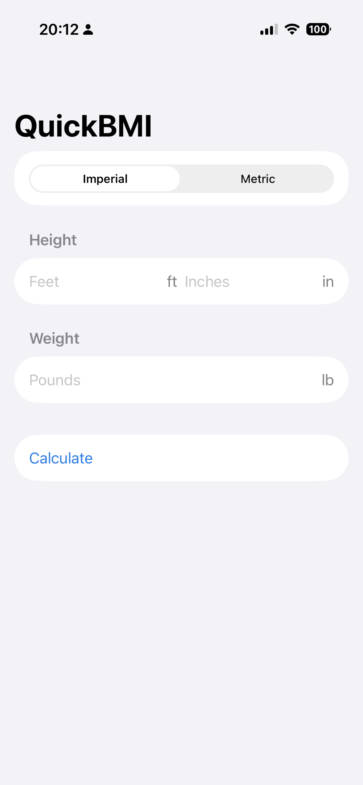
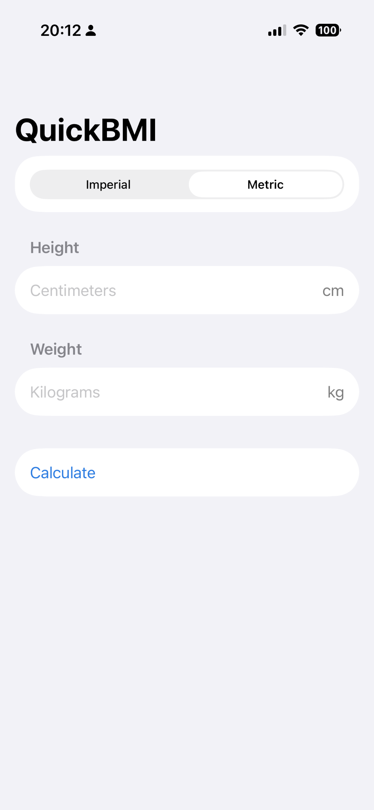
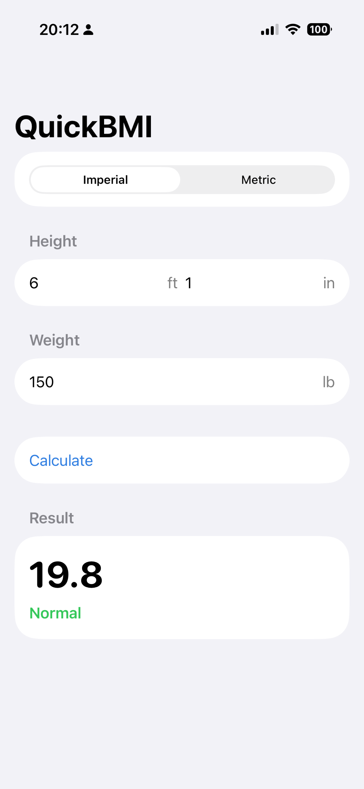
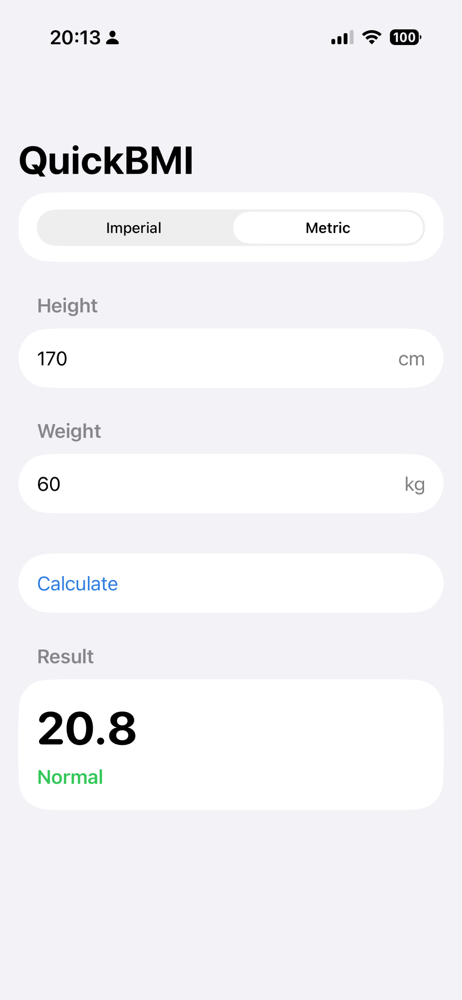

# QuickBMI

A minimal, native iPhone BMI calculator built with SwiftUI. **Live on the App Store.**

[](https://apps.apple.com/us/app/quickbmi-calc/id6797564188)

**➡️ [QuickBMI Calc on the App Store](https://apps.apple.com/us/app/quickbmi-calc/id6797564188)** — free, iPhone, iOS 17+

The app itself is intentionally simple. Its real purpose was to validate the full pipeline for shipping an app to the Apple App Store end to end: code signing, TestFlight, listing metadata, App Review (including a couple of review rounds), and release. That goal is done — the app is published and available worldwide.

## Features

- Height and weight input with an **Imperial** (lb, ft/in) ↔ **Metric** (kg, cm) toggle
- Instant BMI with its category: Underweight, Normal, Overweight, or Obese
- Light and dark mode
- No sign-up, no ads, no analytics, no data collection — nothing is stored between sessions

BMI is `weight_kg / height_m²`. Category thresholds: under 18.5 Underweight, 18.5–24.9 Normal, 25–29.9 Overweight, 30+ Obese ([CDC reference](https://www.cdc.gov/bmi/about/index.html)). BMI is a screening tool, not a medical diagnosis.

## Screenshots

<p>
  
  
  
  
</p>

## Tech stack

| | |
|---|---|
| UI | SwiftUI (single `NavigationStack` + `Form`) |
| Language | Swift 5 |
| Deployment target | iOS 17.0, iPhone only |
| Bundle ID | `com.aaronxu.quickbmi` |
| Project generation | [XcodeGen](https://github.com/yonaskolb/XcodeGen) (`project.yml` → `QuickBMI.xcodeproj`) |
| Dependencies | None |

## Project layout

```
QuickBMI/Sources/
  QuickBMIApp.swift     App entry point
  ContentView.swift     Calculator UI
  BMICalculator.swift   Unit systems, BMI math, category thresholds
QuickBMI/Assets.xcassets   App icon and accent color
project.yml                XcodeGen spec (version / build number live here)
Screenshots/               App Store screenshots
docs/                      Privacy policy + support site (GitHub Pages), logbook, ADRs
CONTEXT.md                 Domain glossary and non-goals
PLAN.md                    Original ship plan
```

## Build and run

Requires Xcode (with an iOS 17+ SDK).

```bash
# optional: regenerate the Xcode project after editing project.yml
brew install xcodegen && xcodegen generate

open QuickBMI.xcodeproj
```

Pick an iPhone simulator or a connected device and press Run. To archive for distribution, set your own `DEVELOPMENT_TEAM` and bundle ID in Xcode (the project uses automatic signing).

## Links

- App Store: <https://apps.apple.com/us/app/quickbmi-calc/id6797564188>
- Support and privacy policy: <https://arronshaw.github.io/quickbmi/> · [Privacy policy](https://arronshaw.github.io/quickbmi/privacy.html)
- Design decisions: [docs/adr](docs/adr)

## Version history

- **2.0** — current App Store release. Adds a CDC citation link for the BMI formula and category ranges.
- **1.x** — first release, published on the App Store on 2026-08-20 after App Review.

## Author

Aaron Xu · aaronxuwp@gmail.com
